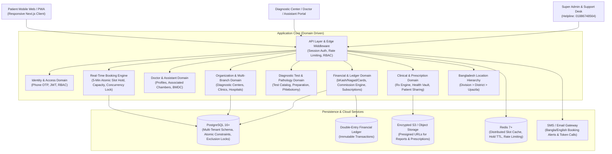
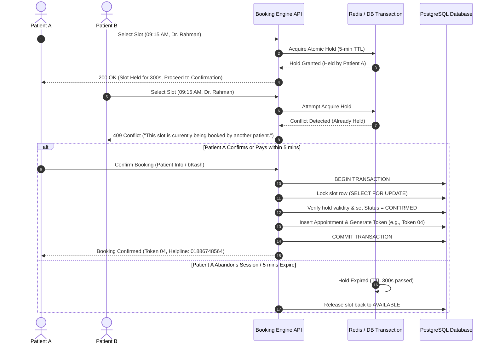

# Diagnostic Care — System Architecture Specification

**Brand:** Diagnostic Care | Your Healthcare Marketplace  
**Customer Care:** 01886748564  
**Company Email:** diagonosticcare@gmail.com  
**Primary B2B Customer:** Diagnostic Centers  
**Initial Deployment Focus:** Moulvibazar, Sylhet Division, Bangladesh  
**Architecture Style:** High-Performance Modular Domain Monolith with Cloud-Native Event Extension  

---

## 1. High-Level Architectural Overview

Diagnostic Care is architected as a **Domain-Driven Modular Monolith** implemented with TypeScript, Next.js App Router, and PostgreSQL. It delivers sub-second response times across Bangladesh networks, ensures rock-solid multi-tenant isolation, and prevents duplicate doctor appointments at the database level.



---

## 2. Multi-Tenancy & Data Isolation Model

The platform uses a **Shared-Database, Column-Isolated & Row-Level Enforced Multi-Tenant Architecture**:

1. **Organization as Tenant Root:**
   - Every Diagnostic Center, Clinic, or Hospital is stored in the `organizations` table with a unique `id`.
   - All tenant-owned tables (`branches`, `diagnostic_tests`, `doctor_associations`, `doctor_assistants`, `staff_members`, `test_bookings`, `organization_subscriptions`) have an indexed `organization_id` foreign key.

2. **Branch-Level Granularity:**
   - Organizations with multiple physical locations (e.g., Moulvibazar Main Branch, Sreemangal Branch) manage branch-scoped resources (`branch_id`).
   - Staff members assigned to Branch A cannot access test results or bookings originating from Branch B unless granted organizational-wide supervisory permissions.

3. **Strict Server-Side Enforcement:**
   - Frontend UI hiding is never considered a security boundary.
   - Every API handler, Server Action, and repository query automatically injects and validates the authenticated user's `organization_id` and `branch_id`.
   - Attempts to access another tenant's records immediately fail with `403 Forbidden` and trigger a security audit entry.

---

## 3. Real-Time Booking Engine Architecture

Preventing double-booking while ensuring low latency during high morning rush hours requires a multi-layered concurrency strategy:



### 3.1 Database Invariants
- A PostgreSQL partial unique index ensures that no two appointments can have status `CONFIRMED` or `HELD` for the same `(doctor_association_id, branch_id, appointment_date, start_time)`.
- If two simultaneous transactions attempt to bypass the application layer, the database engine enforces serialization and throws a unique violation (`SQLSTATE 23505`), preventing duplicate bookings under any concurrency condition.

---

## 4. Doctor Associated Accounts & Isolated Assistants

To match physical outpatient chamber realities in Bangladesh:

```
[Diagnostic Center: ABC Diagnostic Center (Moulvibazar)]
  ├── Doctor Association: Dr. Anisur Rahman (MBBS, FCPS)
  │     ├── Chamber Schedule: Sat-Thu, 04:00 PM - 08:00 PM (Branch: Moulvibazar Sadar)
  │     └── Assistant Account: Rahim Uddin (Chamber Assistant)
  │           ├── Permitted View: Today's Queue, Arrived Patients, Token Call
  │           ├── Permitted Data: Patient Name, Mobile Number, Age, Token #
  │           └── STRICTLY RESTRICTED: Other Doctors' Patients, Diagnostic Center Financials, Admin Settings
  └── Doctor Association: Dr. Fatema Khatun (Gynecologist)
        └── Assistant Account: Salma Begum (Chamber Assistant)
```

- **Doctor Association:** A doctor maintains one master profile, but joins an organization via `doctor_associations`. Fees, schedule slots, and commissions are configured per association.
- **Assistant Sandbox:** Assistants authenticate with their own credentials. The authorization middleware resolves their assigned `doctor_id` and restricts all query endpoints exclusively to that doctor's queue. Patient medical histories and billing ledgers are stripped from the response payload.

---

## 5. Secure Healthcare Document Storage

Medical reports and prescriptions are subject to strict privacy rules:

1. **Storage Topology:** Documents are stored in encrypted private cloud object storage (AWS S3 or Supabase Storage with server-side AES-256 encryption).
2. **Access Control:** Buckets are strictly private with no public read permissions.
3. **Signed Tokenized URLs:** When an authenticated patient, doctor, or authorized lab technician accesses a report, the backend generates a cryptographically signed HMAC token or presigned URL with a 15-minute expiration.
4. **Audit Logging:** Every view or download of a diagnostic report or prescription is recorded in `audit_logs` with user ID, IP address, timestamp, and document hash.

---

## 6. Financial Architecture & Double-Entry Ledger

Diagnostic Care features a financial accounting engine to guarantee financial integrity across payments, commissions, and provider disbursements:

```
Patient Pays ৳1000 for CBC + Lipid Profile
  ├── DEBIT:  Gateway Clearing Account (bKash/Nagad/SSL)  = ৳1000
  ├── CREDIT: Diagnostic Center Payable (Provider Balance) = ৳950
  └── CREDIT: Platform Marketplace Commission (5%)         = ৳50
```

- **Immutable Ledger:** Ledger entries cannot be updated or deleted. Reversals or refunds create new compensatory offsetting entries.
- **Provider Subscriptions:** Centers pay SaaS subscription fees (e.g., BDT 200, BDT 500, or Enterprise) recorded separately from patient booking commissions.

---

## 7. Bangladesh Localization & Discovery Architecture

- **Administrative Hierarchy:** Native database entities for Bangladesh Divisions (Dhaka, Sylhet, Chittagong, etc.), Districts (Moulvibazar, Sylhet, Habiganj, etc.), and Upazilas (Moulvibazar Sadar, Sreemangal, Kulaura, etc.).
- **Bilingual i18n:** Built-in translation dictionaries for Bangla (bn-BD) and English (en-US) covering all UI text, statuses, tokens, and patient communications.
- **Helpline Integration:** Customer Care phone number `01886748564` is declared as an immutable brand constant and embedded in all patient confirmation receipts, footer navigations, and support dialogs.
