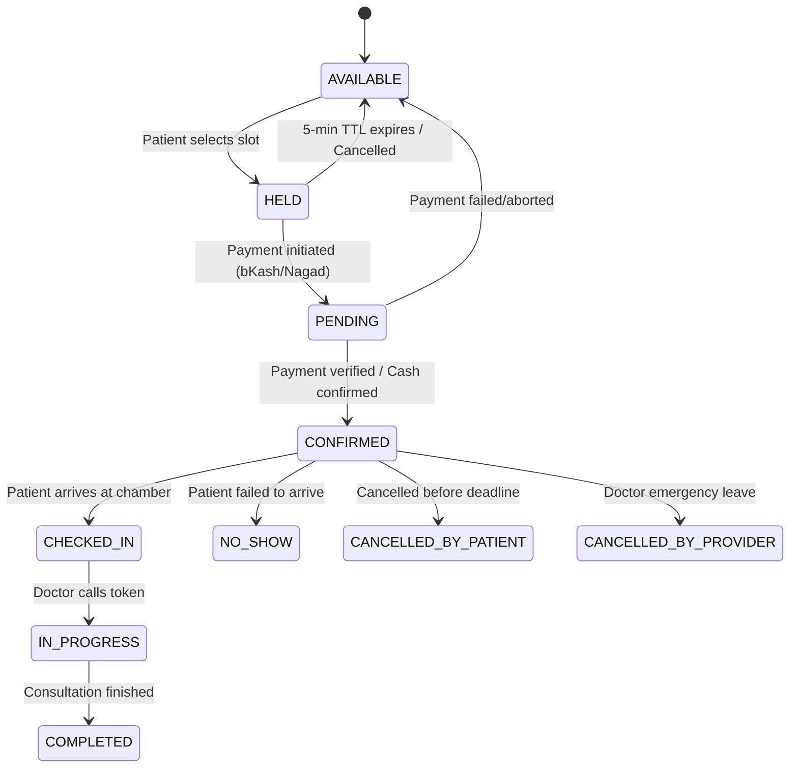

# Diagnostic Care — Real-Time Booking Engine Specification

**Brand:** Diagnostic Care | Your Healthcare Marketplace  
**Helpline:** 01886748564 | **Email:** diagonosticcare@gmail.com  
**Primary B2B Customer:** Diagnostic Centers  
**Engine Domain:** Ultra-Low Latency Slot Generation, 5-Minute Atomic Hold, Concurrency Lock & Live Queue  

---

## 1. Slot Generation Algorithm

Doctor consultation schedules are defined per chamber association:
- **Consultation Days:** (e.g., Saturday through Thursday)
- **Time Window:** `startTime` (08:00 AM) to `endTime` (12:00 PM) = 240 minutes
- **Slot Duration:** `slotDurationMinutes` (e.g., 15 minutes)
- **Maximum Daily Capacity:** `maxPatientCapacity` (e.g., 16 patients)

### Mathematical Slot Computation
$$\text{Total Potential Slots} = \min\left(\left\lfloor \frac{\text{EndTime} - \text{StartTime}}{\text{SlotDuration}} \right\rfloor, \text{MaxCapacity}\right)$$

For 08:00 to 12:00 with 15-minute intervals:
- Slot 1: `08:00 - 08:15`
- Slot 2: `08:15 - 08:30`
- Slot 3: `08:30 - 08:45`
- ...
- Slot 16: `11:45 - 12:00`

If bookings for the day reach `16`, the engine automatically flags the day as `FULL`. The UI immediately renders:
> *"All appointments for today are currently booked. Next available consultation date is Sunday, Oct 12."*

---

## 2. 5-Minute Temporary Slot Hold Mechanism

To prevent race conditions without locking the slot permanently if a patient abandons their checkout:

1. When Patient A clicks an available slot:
   - Server validates slot state.
   - If slot is `AVAILABLE` or (status is `HELD` and `hold_expires_at < NOW()`):
     - Sets `status = 'HELD'`
     - Sets `held_by_user_id = PatientA.id`
     - Sets `hold_expires_at = NOW() + INTERVAL '5 minutes'`
   - Client starts a 300-second countdown timer.
2. If Patient A confirms payment or booking:
   - Slot transitions to `CONFIRMED`.
   - Appointment record is created.
   - Queue token is assigned.
3. If Patient A leaves or timeout expires:
   - Lazy release on next query, or scheduled background worker automatically resets state to `AVAILABLE`.

---

## 3. Database-Level Concurrency & Anti-Double-Booking Lock

Never rely solely on application memory or frontend checks.

### Concurrency Sequence (PostgreSQL Transactional Lock)

```sql
-- Step 1: Atomic acquire with pessimistic locking
BEGIN;

SELECT id, status, hold_expires_at, held_by_user_id
FROM schedule_slots
WHERE id = :slotId
FOR UPDATE;

-- Step 2: Validate state
-- Condition: (status = 'AVAILABLE') OR (status = 'HELD' AND hold_expires_at < NOW())
UPDATE schedule_slots
SET status = 'HELD',
    held_by_user_id = :currentUserId,
    hold_expires_at = NOW() + INTERVAL '5 minutes',
    updated_at = NOW()
WHERE id = :slotId
  AND (status = 'AVAILABLE' OR (status = 'HELD' AND hold_expires_at < NOW()));

-- If 0 rows updated, ROLLBACK and return 409 Conflict
COMMIT;
```

### Absolute Invariant: Partial Unique Constraint
```sql
-- Ensures that under NO circumstance can two active appointments reference the same doctor slot
CREATE UNIQUE INDEX uq_active_slot_booking 
ON appointments(schedule_slot_id) 
WHERE status NOT IN ('CANCELLED_BY_PATIENT', 'CANCELLED_BY_PROVIDER', 'EXPIRED');
```

---

## 4. Booking State Machine



---

## 5. Live Queue & Token Management

When an appointment is confirmed:
1. `token_number` is generated monotonically per doctor chamber per day:
   - `total_tokens_issued = total_tokens_issued + 1`
   - Patient receives `Token 01`, `Token 02`, etc.
2. Live Queue State:
   - `current_token_serving`: Managed by Doctor or Doctor Assistant.
   - `estimated_wait_time`: Computed as:
     $$\text{Estimated Wait} = (\text{PatientToken} - \text{CurrentToken}) \times \text{AvgConsultationMinutes}$$
3. Assistant Actions:
   - `Call Next`: Increments `current_token_serving`, triggers real-time broadcast and SMS alert to the next 2 patients in queue.
   - `Mark Checked In`: Flags physical presence in waiting area.
   - `Mark Completed`: Closes consultation and unlocks digital prescription generation.
