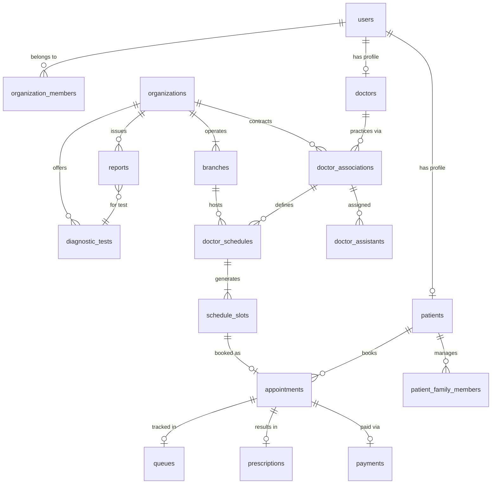

# Diagnostic Care — Database Schema Specification

**Platform:** PostgreSQL 16+  
**Architecture:** Normalized, Multi-Tenant, Row-Isolated, High-Concurrency  
**Brand:** Diagnostic Care | Your Healthcare Marketplace (Helpline: 01886748564)  

---

## 1. Schema Design Principles

1. **UUID Primary Keys:** All tables use `UUIDv4` primary keys to prevent enumeration attacks and support distributed scaling.
2. **Explicit Foreign Keys & Cascades:** Referential integrity is strictly enforced at the database level.
3. **Tenant Scoping:** All organization-owned tables contain an indexed `organization_id` column.
4. **Double Booking Prevention:** A partial unique index guarantees that no two non-cancelled appointments can occupy the same slot.
5. **Auditing & Timestamps:** All tables include `created_at` and `updated_at` with microsecond precision, plus `audit_logs` for sensitive healthcare mutations.

---

## 2. Entity Relationship Diagram (High-Level)



---

## 3. Core Database Tables (SQL DDL Specification)

### 3.1 Geographic Hierarchy (Bangladesh)

```sql
CREATE TABLE divisions (
    id UUID PRIMARY KEY DEFAULT gen_random_uuid(),
    name_en VARCHAR(100) NOT NULL UNIQUE,
    name_bn VARCHAR(100) NOT NULL,
    created_at TIMESTAMPTZ NOT NULL DEFAULT NOW()
);

CREATE TABLE districts (
    id UUID PRIMARY KEY DEFAULT gen_random_uuid(),
    division_id UUID NOT NULL REFERENCES divisions(id) ON DELETE CASCADE,
    name_en VARCHAR(100) NOT NULL UNIQUE,
    name_bn VARCHAR(100) NOT NULL,
    created_at TIMESTAMPTZ NOT NULL DEFAULT NOW()
);
CREATE INDEX idx_districts_division ON districts(division_id);

CREATE TABLE upazilas (
    id UUID PRIMARY KEY DEFAULT gen_random_uuid(),
    district_id UUID NOT NULL REFERENCES districts(id) ON DELETE CASCADE,
    name_en VARCHAR(100) NOT NULL,
    name_bn VARCHAR(100) NOT NULL,
    created_at TIMESTAMPTZ NOT NULL DEFAULT NOW(),
    CONSTRAINT uq_district_upazila UNIQUE(district_id, name_en)
);
CREATE INDEX idx_upazilas_district ON upazilas(district_id);
```

### 3.2 Authentication, Roles & Users

```sql
CREATE TYPE user_role AS ENUM (
    'PATIENT',
    'DOCTOR',
    'DOCTOR_ASSISTANT',
    'DIAGNOSTIC_ADMIN',
    'DIAGNOSTIC_STAFF',
    'CLINIC_ADMIN',
    'CLINIC_STAFF',
    'HOSPITAL_ADMIN',
    'HOSPITAL_STAFF',
    'PHARMACY_ADMIN',
    'PHARMACY_STAFF',
    'AMBULANCE_PROVIDER',
    'HOME_HEALTHCARE_PROVIDER',
    'SUPPORT_AGENT',
    'SALES_AGENT',
    'OPERATIONS_MANAGER',
    'FINANCE_MANAGER',
    'SUPER_ADMIN'
);

CREATE TABLE users (
    id UUID PRIMARY KEY DEFAULT gen_random_uuid(),
    phone VARCHAR(20) NOT NULL UNIQUE,
    email VARCHAR(255) UNIQUE,
    password_hash VARCHAR(255) NOT NULL,
    full_name VARCHAR(150) NOT NULL,
    primary_role user_role NOT NULL DEFAULT 'PATIENT',
    is_active BOOLEAN NOT NULL DEFAULT TRUE,
    is_verified BOOLEAN NOT NULL DEFAULT FALSE,
    avatar_url TEXT,
    language_preference VARCHAR(10) NOT NULL DEFAULT 'bn',
    last_login_at TIMESTAMPTZ,
    created_at TIMESTAMPTZ NOT NULL DEFAULT NOW(),
    updated_at TIMESTAMPTZ NOT NULL DEFAULT NOW()
);
CREATE INDEX idx_users_phone ON users(phone);
CREATE INDEX idx_users_email ON users(email);
```

### 3.3 Organizations & Multi-Branch Structure

```sql
CREATE TYPE org_type AS ENUM (
    'DIAGNOSTIC_CENTER',
    'CLINIC',
    'HOSPITAL',
    'PHARMACY',
    'AMBULANCE_AGENCY',
    'HOME_HEALTHCARE_AGENCY'
);

CREATE TYPE verification_status AS ENUM (
    'PENDING',
    'UNDER_REVIEW',
    'VERIFIED',
    'REJECTED',
    'SUSPENDED'
);

CREATE TABLE organizations (
    id UUID PRIMARY KEY DEFAULT gen_random_uuid(),
    name VARCHAR(255) NOT NULL,
    slug VARCHAR(255) NOT NULL UNIQUE,
    org_type org_type NOT NULL DEFAULT 'DIAGNOSTIC_CENTER',
    trade_license_number VARCHAR(100),
    registration_document_url TEXT,
    logo_url TEXT,
    banner_url TEXT,
    contact_phone VARCHAR(20) NOT NULL,
    contact_email VARCHAR(255),
    verification_status verification_status NOT NULL DEFAULT 'PENDING',
    verified_at TIMESTAMPTZ,
    is_featured BOOLEAN NOT NULL DEFAULT FALSE,
    created_at TIMESTAMPTZ NOT NULL DEFAULT NOW(),
    updated_at TIMESTAMPTZ NOT NULL DEFAULT NOW()
);
CREATE INDEX idx_orgs_slug ON organizations(slug);
CREATE INDEX idx_orgs_type_status ON organizations(org_type, verification_status);

CREATE TABLE branches (
    id UUID PRIMARY KEY DEFAULT gen_random_uuid(),
    organization_id UUID NOT NULL REFERENCES organizations(id) ON DELETE CASCADE,
    name VARCHAR(200) NOT NULL,
    is_main_branch BOOLEAN NOT NULL DEFAULT FALSE,
    upazila_id UUID NOT NULL REFERENCES upazilas(id),
    address_line TEXT NOT NULL,
    latitude DECIMAL(10, 7),
    longitude DECIMAL(10, 7),
    phone VARCHAR(20) NOT NULL,
    email VARCHAR(255),
    opening_time TIME NOT NULL DEFAULT '08:00:00',
    closing_time TIME NOT NULL DEFAULT '22:00:00',
    is_active BOOLEAN NOT NULL DEFAULT TRUE,
    created_at TIMESTAMPTZ NOT NULL DEFAULT NOW(),
    updated_at TIMESTAMPTZ NOT NULL DEFAULT NOW()
);
CREATE INDEX idx_branches_org ON branches(organization_id);
CREATE INDEX idx_branches_upazila ON branches(upazila_id);

CREATE TABLE organization_members (
    id UUID PRIMARY KEY DEFAULT gen_random_uuid(),
    organization_id UUID NOT NULL REFERENCES organizations(id) ON DELETE CASCADE,
    branch_id UUID REFERENCES branches(id) ON DELETE SET NULL,
    user_id UUID NOT NULL REFERENCES users(id) ON DELETE CASCADE,
    role user_role NOT NULL,
    is_active BOOLEAN NOT NULL DEFAULT TRUE,
    created_at TIMESTAMPTZ NOT NULL DEFAULT NOW(),
    CONSTRAINT uq_org_user_role UNIQUE(organization_id, user_id, role)
);
CREATE INDEX idx_org_members_user ON organization_members(user_id);
```

### 3.4 Doctors, Associations & Isolated Assistants

```sql
CREATE TABLE doctors (
    id UUID PRIMARY KEY DEFAULT gen_random_uuid(),
    user_id UUID NOT NULL UNIQUE REFERENCES users(id) ON DELETE CASCADE,
    bmdc_number VARCHAR(50) NOT NULL UNIQUE,
    title VARCHAR(50) NOT NULL DEFAULT 'Dr.',
    specialization VARCHAR(150) NOT NULL,
    qualifications TEXT NOT NULL,
    experience_years INT NOT NULL DEFAULT 1,
    biography TEXT,
    consultation_languages VARCHAR(100)[] DEFAULT ARRAY['Bangla', 'English'],
    verification_status verification_status NOT NULL DEFAULT 'PENDING',
    created_at TIMESTAMPTZ NOT NULL DEFAULT NOW(),
    updated_at TIMESTAMPTZ NOT NULL DEFAULT NOW()
);
CREATE INDEX idx_doctors_specialization ON doctors(specialization);

CREATE TABLE doctor_associations (
    id UUID PRIMARY KEY DEFAULT gen_random_uuid(),
    doctor_id UUID NOT NULL REFERENCES doctors(id) ON DELETE CASCADE,
    organization_id UUID NOT NULL REFERENCES organizations(id) ON DELETE CASCADE,
    branch_id UUID NOT NULL REFERENCES branches(id) ON DELETE CASCADE,
    chamber_room_number VARCHAR(50),
    consultation_fee DECIMAL(10, 2) NOT NULL,
    followup_fee DECIMAL(10, 2) NOT NULL DEFAULT 0.00,
    followup_validity_days INT NOT NULL DEFAULT 14,
    commission_rate DECIMAL(5, 2) NOT NULL DEFAULT 5.00,
    is_active BOOLEAN NOT NULL DEFAULT TRUE,
    created_at TIMESTAMPTZ NOT NULL DEFAULT NOW(),
    CONSTRAINT uq_doctor_branch UNIQUE(doctor_id, branch_id)
);
CREATE INDEX idx_doc_assoc_org ON doctor_associations(organization_id);
CREATE INDEX idx_doc_assoc_branch ON doctor_associations(branch_id);

CREATE TABLE doctor_assistants (
    id UUID PRIMARY KEY DEFAULT gen_random_uuid(),
    user_id UUID NOT NULL REFERENCES users(id) ON DELETE CASCADE,
    doctor_association_id UUID NOT NULL REFERENCES doctor_associations(id) ON DELETE CASCADE,
    can_manage_queue BOOLEAN NOT NULL DEFAULT TRUE,
    can_view_patient_vitals BOOLEAN NOT NULL DEFAULT FALSE,
    is_active BOOLEAN NOT NULL DEFAULT TRUE,
    created_at TIMESTAMPTZ NOT NULL DEFAULT NOW(),
    CONSTRAINT uq_assistant_association UNIQUE(user_id, doctor_association_id)
);
CREATE INDEX idx_assistants_assoc ON doctor_assistants(doctor_association_id);
```

### 3.5 Schedules, Concurrency Slots & Appointments

```sql
CREATE TYPE day_of_week AS ENUM ('SATURDAY', 'SUNDAY', 'MONDAY', 'TUESDAY', 'WEDNESDAY', 'THURSDAY', 'FRIDAY');

CREATE TABLE doctor_schedules (
    id UUID PRIMARY KEY DEFAULT gen_random_uuid(),
    doctor_association_id UUID NOT NULL REFERENCES doctor_associations(id) ON DELETE CASCADE,
    day_of_week day_of_week NOT NULL,
    start_time TIME NOT NULL,
    end_time TIME NOT NULL,
    slot_duration_minutes INT NOT NULL DEFAULT 15,
    max_patient_capacity INT NOT NULL DEFAULT 20,
    is_active BOOLEAN NOT NULL DEFAULT TRUE,
    created_at TIMESTAMPTZ NOT NULL DEFAULT NOW(),
    CONSTRAINT uq_schedule_day UNIQUE(doctor_association_id, day_of_week)
);

CREATE TYPE slot_status AS ENUM (
    'AVAILABLE',
    'HELD',
    'CONFIRMED',
    'BLOCKED'
);

CREATE TABLE schedule_slots (
    id UUID PRIMARY KEY DEFAULT gen_random_uuid(),
    doctor_schedule_id UUID NOT NULL REFERENCES doctor_schedules(id) ON DELETE CASCADE,
    doctor_association_id UUID NOT NULL REFERENCES doctor_associations(id) ON DELETE CASCADE,
    branch_id UUID NOT NULL REFERENCES branches(id) ON DELETE CASCADE,
    slot_date DATE NOT NULL,
    start_time TIME NOT NULL,
    end_time TIME NOT NULL,
    status slot_status NOT NULL DEFAULT 'AVAILABLE',
    held_by_user_id UUID REFERENCES users(id) ON DELETE SET NULL,
    hold_expires_at TIMESTAMPTZ,
    created_at TIMESTAMPTZ NOT NULL DEFAULT NOW(),
    updated_at TIMESTAMPTZ NOT NULL DEFAULT NOW(),
    CONSTRAINT uq_slot_unique_booking UNIQUE(doctor_association_id, branch_id, slot_date, start_time)
);
CREATE INDEX idx_slots_search ON schedule_slots(doctor_association_id, slot_date, status);

CREATE TYPE appointment_status AS ENUM (
    'AVAILABLE',
    'HELD',
    'PENDING',
    'CONFIRMED',
    'CHECKED_IN',
    'IN_PROGRESS',
    'COMPLETED',
    'CANCELLED_BY_PATIENT',
    'CANCELLED_BY_PROVIDER',
    'NO_SHOW',
    'EXPIRED',
    'WAITLISTED'
);

CREATE TABLE appointments (
    id UUID PRIMARY KEY DEFAULT gen_random_uuid(),
    booking_code VARCHAR(20) NOT NULL UNIQUE,
    schedule_slot_id UUID NOT NULL UNIQUE REFERENCES schedule_slots(id),
    doctor_association_id UUID NOT NULL REFERENCES doctor_associations(id),
    branch_id UUID NOT NULL REFERENCES branches(id),
    patient_user_id UUID NOT NULL REFERENCES users(id),
    patient_name VARCHAR(150) NOT NULL,
    patient_phone VARCHAR(20) NOT NULL,
    patient_age INT NOT NULL,
    patient_gender VARCHAR(10) NOT NULL,
    consultation_fee DECIMAL(10, 2) NOT NULL,
    platform_commission DECIMAL(10, 2) NOT NULL DEFAULT 0.00,
    status appointment_status NOT NULL DEFAULT 'CONFIRMED',
    token_number INT NOT NULL,
    notes TEXT,
    created_at TIMESTAMPTZ NOT NULL DEFAULT NOW(),
    updated_at TIMESTAMPTZ NOT NULL DEFAULT NOW()
);
CREATE INDEX idx_appointments_patient ON appointments(patient_user_id);
CREATE INDEX idx_appointments_doc_branch ON appointments(doctor_association_id, branch_id, status);

CREATE TABLE queues (
    id UUID PRIMARY KEY DEFAULT gen_random_uuid(),
    doctor_association_id UUID NOT NULL REFERENCES doctor_associations(id) ON DELETE CASCADE,
    queue_date DATE NOT NULL,
    current_token_serving INT NOT NULL DEFAULT 0,
    total_tokens_issued INT NOT NULL DEFAULT 0,
    created_at TIMESTAMPTZ NOT NULL DEFAULT NOW(),
    updated_at TIMESTAMPTZ NOT NULL DEFAULT NOW(),
    CONSTRAINT uq_daily_queue UNIQUE(doctor_association_id, queue_date)
);
```

### 3.6 Diagnostic Tests, Bookings & Secure Reports

```sql
CREATE TABLE diagnostic_tests (
    id UUID PRIMARY KEY DEFAULT gen_random_uuid(),
    organization_id UUID NOT NULL REFERENCES organizations(id) ON DELETE CASCADE,
    name VARCHAR(255) NOT NULL,
    code VARCHAR(50),
    category VARCHAR(100) NOT NULL,
    description TEXT,
    preparation_instructions TEXT,
    sample_type VARCHAR(100),
    expected_delivery_hours INT NOT NULL DEFAULT 24,
    price DECIMAL(10, 2) NOT NULL,
    discount_price DECIMAL(10, 2),
    home_collection_available BOOLEAN NOT NULL DEFAULT FALSE,
    is_active BOOLEAN NOT NULL DEFAULT TRUE,
    created_at TIMESTAMPTZ NOT NULL DEFAULT NOW(),
    updated_at TIMESTAMPTZ NOT NULL DEFAULT NOW()
);
CREATE INDEX idx_diag_tests_org ON diagnostic_tests(organization_id);
CREATE INDEX idx_diag_tests_category ON diagnostic_tests(category);

CREATE TABLE diagnostic_bookings (
    id UUID PRIMARY KEY DEFAULT gen_random_uuid(),
    booking_code VARCHAR(20) NOT NULL UNIQUE,
    organization_id UUID NOT NULL REFERENCES organizations(id),
    branch_id UUID NOT NULL REFERENCES branches(id),
    patient_user_id UUID NOT NULL REFERENCES users(id),
    booking_date DATE NOT NULL,
    home_collection BOOLEAN NOT NULL DEFAULT FALSE,
    collection_address TEXT,
    total_amount DECIMAL(10, 2) NOT NULL,
    status VARCHAR(50) NOT NULL DEFAULT 'CONFIRMED',
    created_at TIMESTAMPTZ NOT NULL DEFAULT NOW()
);

CREATE TABLE diagnostic_reports (
    id UUID PRIMARY KEY DEFAULT gen_random_uuid(),
    diagnostic_booking_id UUID NOT NULL REFERENCES diagnostic_bookings(id) ON DELETE CASCADE,
    diagnostic_test_id UUID NOT NULL REFERENCES diagnostic_tests(id),
    patient_user_id UUID NOT NULL REFERENCES users(id),
    secure_file_path TEXT NOT NULL,
    file_name VARCHAR(255) NOT NULL,
    file_size_bytes BIGINT NOT NULL,
    mime_type VARCHAR(100) NOT NULL DEFAULT 'application/pdf',
    verified_by_name VARCHAR(150),
    verified_by_designation VARCHAR(150),
    released_at TIMESTAMPTZ NOT NULL DEFAULT NOW(),
    created_at TIMESTAMPTZ NOT NULL DEFAULT NOW()
);
CREATE INDEX idx_reports_patient ON diagnostic_reports(patient_user_id);
```

### 3.7 Digital Prescriptions

```sql
CREATE TABLE prescriptions (
    id UUID PRIMARY KEY DEFAULT gen_random_uuid(),
    appointment_id UUID UNIQUE REFERENCES appointments(id) ON DELETE SET NULL,
    doctor_id UUID NOT NULL REFERENCES doctors(id),
    patient_user_id UUID NOT NULL REFERENCES users(id),
    clinical_notes TEXT,
    diagnosis TEXT,
    followup_date DATE,
    created_at TIMESTAMPTZ NOT NULL DEFAULT NOW()
);
CREATE INDEX idx_prescriptions_patient ON prescriptions(patient_user_id);

CREATE TABLE prescription_medicines (
    id UUID PRIMARY KEY DEFAULT gen_random_uuid(),
    prescription_id UUID NOT NULL REFERENCES prescriptions(id) ON DELETE CASCADE,
    medicine_name VARCHAR(255) NOT NULL,
    dosage_pattern VARCHAR(50) NOT NULL, -- e.g. '1+0+1'
    meal_instruction VARCHAR(50) NOT NULL, -- e.g. 'After Meal'
    duration_days INT NOT NULL,
    special_notes TEXT
);
```

### 3.8 Payments & Immutable Financial Ledger

```sql
CREATE TYPE payment_gateway AS ENUM ('BKASH', 'NAGAD', 'ROCKET', 'SSLCOMMERZ', 'CASH_AT_DESK');
CREATE TYPE payment_status AS ENUM ('INITIATED', 'PENDING', 'PAID', 'FAILED', 'REFUNDED', 'CANCELLED');

CREATE TABLE payments (
    id UUID PRIMARY KEY DEFAULT gen_random_uuid(),
    transaction_reference VARCHAR(100) NOT NULL UNIQUE,
    gateway payment_gateway NOT NULL,
    gateway_transaction_id VARCHAR(150),
    amount DECIMAL(10, 2) NOT NULL,
    currency VARCHAR(10) NOT NULL DEFAULT 'BDT',
    status payment_status NOT NULL DEFAULT 'INITIATED',
    patient_user_id UUID NOT NULL REFERENCES users(id),
    appointment_id UUID REFERENCES appointments(id),
    diagnostic_booking_id UUID REFERENCES diagnostic_bookings(id),
    paid_at TIMESTAMPTZ,
    created_at TIMESTAMPTZ NOT NULL DEFAULT NOW()
);
CREATE INDEX idx_payments_status ON payments(status);

CREATE TYPE ledger_account AS ENUM (
    'GATEWAY_CLEARING',
    'PROVIDER_PAYABLE',
    'PLATFORM_COMMISSION',
    'REFUND_PAYABLE',
    'SUBSCRIPTION_REVENUE'
);

CREATE TYPE ledger_entry_type AS ENUM ('DEBIT', 'CREDIT');

CREATE TABLE ledger_entries (
    id UUID PRIMARY KEY DEFAULT gen_random_uuid(),
    payment_id UUID REFERENCES payments(id),
    organization_id UUID REFERENCES organizations(id),
    account ledger_account NOT NULL,
    entry_type ledger_entry_type NOT NULL,
    amount DECIMAL(12, 2) NOT NULL,
    currency VARCHAR(10) NOT NULL DEFAULT 'BDT',
    description TEXT NOT NULL,
    created_at TIMESTAMPTZ NOT NULL DEFAULT NOW()
);
CREATE INDEX idx_ledger_org ON ledger_entries(organization_id);
```

### 3.9 SaaS Subscriptions & Plans

```sql
CREATE TABLE subscription_plans (
    id UUID PRIMARY KEY DEFAULT gen_random_uuid(),
    code VARCHAR(50) NOT NULL UNIQUE,
    name VARCHAR(100) NOT NULL,
    monthly_price DECIMAL(10, 2) NOT NULL,
    yearly_price DECIMAL(10, 2) NOT NULL,
    max_branches INT NOT NULL DEFAULT 1,
    max_doctors INT NOT NULL DEFAULT 3,
    max_staff INT NOT NULL DEFAULT 5,
    commission_discount_percent DECIMAL(5, 2) DEFAULT 0.00,
    features JSONB NOT NULL DEFAULT '{}'::jsonb,
    is_active BOOLEAN NOT NULL DEFAULT TRUE,
    created_at TIMESTAMPTZ NOT NULL DEFAULT NOW()
);

CREATE TABLE organization_subscriptions (
    id UUID PRIMARY KEY DEFAULT gen_random_uuid(),
    organization_id UUID NOT NULL REFERENCES organizations(id) ON DELETE CASCADE,
    plan_id UUID NOT NULL REFERENCES subscription_plans(id),
    start_date DATE NOT NULL,
    end_date DATE NOT NULL,
    status VARCHAR(50) NOT NULL DEFAULT 'ACTIVE',
    auto_renew BOOLEAN NOT NULL DEFAULT TRUE,
    created_at TIMESTAMPTZ NOT NULL DEFAULT NOW()
);
```

### 3.10 Security Audit Logs

```sql
CREATE TABLE audit_logs (
    id UUID PRIMARY KEY DEFAULT gen_random_uuid(),
    user_id UUID REFERENCES users(id),
    organization_id UUID REFERENCES organizations(id),
    action VARCHAR(100) NOT NULL,
    resource_type VARCHAR(100) NOT NULL,
    resource_id VARCHAR(100) NOT NULL,
    ip_address VARCHAR(45),
    user_agent TEXT,
    metadata JSONB,
    created_at TIMESTAMPTZ NOT NULL DEFAULT NOW()
);
CREATE INDEX idx_audit_user ON audit_logs(user_id);
CREATE INDEX idx_audit_resource ON audit_logs(resource_type, resource_id);
CREATE INDEX idx_audit_org ON audit_logs(organization_id);
```
