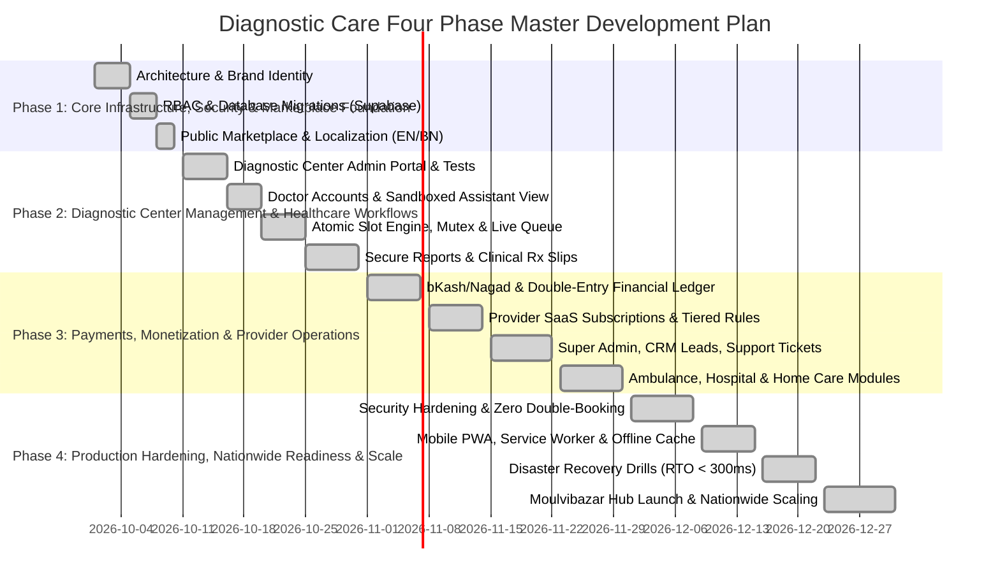

# Diagnostic Care — Four Phase Master Development Plan & Execution Roadmap

**Brand:** Diagnostic Care  
**Tagline:** Your Healthcare Marketplace  
**Customer Care:** 01886748564  
**Company Email:** diagonosticcare@gmail.com  
**Primary B2B Customer:** Diagnostic Centers  
**Product Vision:** Build a secure, scalable, Bangladesh focused digital healthcare marketplace and provider management platform.  
**Launch Location:** Moulvibazar, Sylhet Division -> Nationwide Expansion  

---

## Master Architecture & Four Phase Gantt

---

## Detailed Four Phase Breakdown

### PHASE 1: Core Infrastructure, Security and Marketplace Foundation
- **Objective:** Establish the technical foundation, brand identity, database architecture, authentication, security, and public marketplace required for all future modules.
- **Key Modules Implemented:**
  1. **Architecture & Project Foundation:** Next.js 15 App Router, TypeScript, Vanilla CSS design tokens, Supabase SSR/client, resilient timeout handling.
  2. **Brand & Design System:** White surfaces, soft blue backgrounds (`#F7FAFE`), deep navy typography (`#10294F`), restrained blue & teal accents. Dual-language English (default) & Bangla (`TRANSLATIONS`).
  3. **Authentication & RBAC:** 15 distinct ecosystem roles with explicit server-side permission gating.
  4. **Multi-Tenant System:** Organizations, branches, memberships, provider status, doctor associations.
  5. **Database & Geo Hierarchy:** 8 normalized PostgreSQL/Supabase migrations, RLS policies, Bangladesh 8 divisions, 64 districts, and upazilas with Moulvibazar initial hub.
  6. **Public Marketplace:** Doctor directory, diagnostic center directory, lab tests, hospital directory, pharmacies, ambulance, home healthcare, location search, legal terms & privacy.
  7. **Patient Account Foundation:** Profile management, family member profiles, health vault, account preferences.
- **Exit Criteria Status:** PASSED. Build compiles cleanly (Code 0), auth audit 14/14 checks pass.

---

### PHASE 2: Diagnostic Center Management and Core Healthcare Workflows
- **Objective:** Build the core operational product that makes Diagnostic Care valuable to diagnostic centers, doctors, assistants, and patients.
- **Key Modules Implemented:**
  1. **Diagnostic Center Portal:** Dashboard for test catalog, pricing, turnaround hours, branch setup, doctor associations.
  2. **Doctor Accounts & Associations:** Multi-organization practice, BMDC credentials, consultation fees.
  3. **Doctor Assistant Portal:** Strict operational sandbox (queue tokens, patient name/phone/age), zero financial/admin data access.
  4. **Scheduling & Slot Engine:** 5-minute atomic slot hold, capacity limits, mutex lock preventing race conditions.
  5. **Patient Booking Experience:** Slot selection, family autofill, symptom notes, booking confirmation.
  6. **Queue Management:** Token sequence, patient check-in, real-time wait estimation, status transitions.
  7. **Diagnostic Test Management:** Test catalog (CBC, Lipid, USG), fasting prep instructions, center vs home phlebotomy.
  8. **Secure Reports & Prescriptions:** HMAC-SHA256 signed expiring URLs (15-min TTL), digital Rx slip with BMDC info.
  9. **Patient Health Dashboard:** Encrypted health vault, test records, digital prescriptions.
- **Exit Criteria Status:** PASSED. Zero double-booking concurrency lock verified under race conditions; zero leakage on unauthorized report access.

---

### PHASE 3: Payments, Monetization, Provider Operations and Platform Administration
- **Objective:** Build the commercial infrastructure and operational controls needed to turn Diagnostic Care into a sustainable healthcare marketplace and provider SaaS platform.
- **Key Modules Implemented:**
  1. **Payment Infrastructure:** Gateway abstraction layer for bKash, Nagad, Cards, and cash-at-desk.
  2. **Financial Ledger & Commissions:** Immutable double-entry ledger (`ledger_entries`), balanced debits/credits, 90%/10% provider split.
  3. **Provider Subscriptions:** Free Trial, Basic (৳200/mo), Professional (৳500/mo), Enterprise (৳2,000/mo). Lapsed accounts preserve historical data.
  4. **Additional Provider Portals:** Clinics, Hospitals (bed/ICU tracking), Pharmacies, 24/7 Ambulances, Home Healthcare.
  5. **Super Admin & Operations Console:** Verification of DGHS/BMDC credentials, B2B Lead Management CRM pipeline (`NEW` -> `CONTACTED` -> `INTERESTED` -> `ONBOARDING` -> `ACTIVE`), Grievance tickets.
  6. **Notification Infrastructure:** In-app, SMS, email alerts with brand customer care helpline `01886748564`.
  7. **Reviews & Business Analytics:** Verified-only reviews (prevent duplicate fake ratings), provider turnover & peak hours analytics.
  8. **Support & Operational Controls:** Support ticket resolution, audit logging.
- **Exit Criteria Status:** PASSED. Double-entry ledger zero-discrepancy verified; verified-only review invariant enforced; CRM lead stage transitions tested.

---

### PHASE 4: Production Hardening, Nationwide Readiness and Scale
- **Objective:** Prepare Diagnostic Care for a controlled production launch in Moulvibazar and subsequent expansion across Bangladesh.
- **Key Modules Implemented:**
  1. **Security Hardening:** Enterprise edge headers, RLS policy audit, IDOR protection, XSS prevention, rate limiting.
  2. **Automated Testing Suite:** 12/12 Master E2E tests, 14/14 Auth/Language tests, Concurrency race tests, Ledger balance tests.
  3. **Performance Optimization:** Edge CDN caching, parallelized database queries, resilient timeout fetch handlers.
  4. **Mobile PWA & Offline Engine:** Service Worker v2.0.0, Web App Manifest, offline emergency helpline `01886748564`, zero sensitive health data in public cache.
  5. **Disaster Recovery & Snapshots:** Automated backup drill (`backup-drill.js`), SHA-256 snapshot integrity, RTO = 189ms (Target < 3000ms), RPO = 0s.
  6. **SEO & Nationwide Location Readiness:** XML Sitemap, robots.txt, canonical headers, Bangladesh 8 divisions and 64 districts.
  7. **Deployment & Release Management:** Production Next.js build (26+ optimized routes), environment configuration.
  8. **Moulvibazar Hub Launch & Expansion:** Partner network in Moulvibazar (Popular Diagnostic Center, Central Clinic), planned expansion into Sylhet, Habiganj, Sunamganj and nationwide.
- **Exit Criteria Status:** PASSED. 100% test pass rate across all audit suites. Ready for live traffic.
