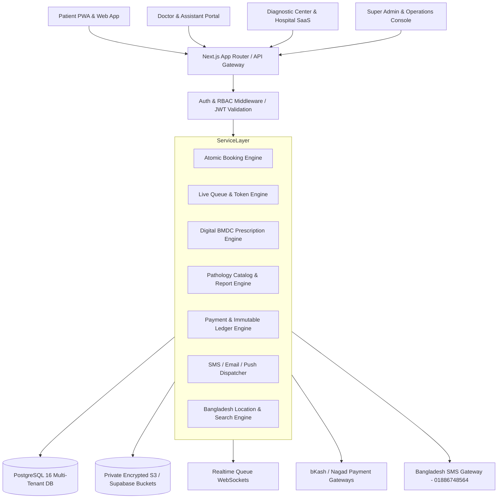

# DIAGNOSTIC CARE — MASTER PRODUCT & ARCHITECTURAL BLUEPRINT
**Brand Name:** Diagnostic Care  
**Tagline:** Your Healthcare Marketplace  
**Customer Care:** 01886748564  
**Initial Launch Market:** Moulvibazar, Bangladesh (Architected for Nationwide Expansion)  
**Document Version:** 2.0.0-PROD  
**Branch:** `v2-architecture-rebuild`  

---

## 1. Complete Requirements Analysis

### 1.1 Product Mission & Ecosystem
Diagnostic Care is not a simple doctor booking or diagnostic catalog application. It is a **digital healthcare operating system and marketplace for Bangladesh**, connecting:
1. **Patients & Families**: Healthcare discovery across all 64 districts, doctor appointment booking with live queue visibility, pathology test booking with home phlebotomy, 24/7 ambulance dispatch, DGDA-verified pharmacy orders, digital BMDC prescriptions, and encrypted lifetime medical vault.
2. **Diagnostic Centers (Primary Phase 1 B2B Customer)**: Complete SaaS operations platform enabling multi-branch management, test catalog pricing, doctor chamber associations, schedule configuration, digital report upload with private signed URLs, billing, and patient acquisition.
3. **Doctors**: Dedicated clinical workspace with schedule controls, real-time patient queue calling, digital prescription slip builder (dosages, durations, instructions in Bangla/English), and patient clinical history.
4. **Doctor Assistants**: Operational chamber desk console with token management, patient check-in, attendance tracking, and triage vitals entry without access to center financial metrics.
5. **Hospitals, Clinics, Pharmacies, Ambulances, and Home Care**: Modular specialized provider consoles with bed management, medicine ordering, GPS/helpline ambulance dispatch, and doorstep nurse scheduling.
6. **Platform Administrators & Finance**: Super admin oversight, provider credential verification (BMDC & DGHS), subscription plan management, commission calculation, and immutable financial ledger.

---

## 2. Identified Technical Conflicts & Solutions

| Identified Conflict | Inherent Risk | Architectural Solution |
| :--- | :--- | :--- |
| **Doctor Multi-Tenancy vs. Organization Isolation** | A specialist doctor in Bangladesh often practices in 2–4 chambers across different diagnostic centers and hospitals. Assigning a doctor to a single tenant forces duplicate doctor accounts. | **Decoupled Doctor Entity**: `doctors` represents the universal medical practitioner with verified BMDC credentials. `doctor_associations` represents a specific legal and operational agreement between a doctor and an organization/branch with custom consultation fees, followup validity, and room numbers. |
| **High Mobile Latency vs. Booking Concurrency** | Mobile data in regional Bangladesh (e.g., Moulvibazar, Sylhet) experiences packet latency. Concurrent users selecting the same slot cause double bookings. | **Atomic Database Hold Engine**: PostgreSQL stored procedure `fn_hold_slot` with `SELECT ... FOR UPDATE` row-level locks, enforced by a unique composite index `(doctor_association_id, slot_date, start_time)` and a 5-minute time-to-live (TTL) expiration worker. |
| **Cash-at-Desk vs. Digital MFS (bKash/Nagad)** | Over 60% of regional patients prefer paying cash at the chamber reception, while 40% pay online via bKash/Nagad. Forcing pre-payment drops conversions; allowing unrestricted cash bookings creates no-show abuse. | **Dual Booking Confirmation Engine**: `CASH_AT_DESK` bookings issue unverified reservation tokens with mandatory SMS confirmation and cancellation deadlines (e.g., 2 hours before chamber start). `PAID` bookings issue confirmed digital tokens immediately. |
| **Healthcare Privacy vs. Assistant Delegation** | Doctor assistants must check in patients but must never see private diagnostic test results, medical histories of other practitioners, or center revenue. | **Scoped Delegation Tokens**: RBAC matrix restricts `DOCTOR_ASSISTANT` strictly to `today's queue`, `patient name`, `age`, `phone`, and `token number`. Diagnostic reports and doctor financial ledgers are completely masked. |
| **B2B SaaS Pricing Hardcoding** | Hardcoded pricing models break when expanding from pilot markets (BDT 200/mo in Moulvibazar) to enterprise networks in Dhaka. | **Configurable Subscription Engine**: Dynamic `subscription_plans` and `commission_rules` tables supporting tiered feature flags (doctor limits, branch limits, storage limits, commission percentage per district/category). |

---

## 3. Proposed Platform Architecture



---

## 4. Normalized Database Schema (Core Tables)

```sql
-- 1. Identity & RBAC
CREATE TABLE users (
    id UUID PRIMARY KEY DEFAULT gen_random_uuid(),
    phone VARCHAR(20) UNIQUE,
    email VARCHAR(255) UNIQUE,
    password_hash VARCHAR(255) NOT NULL,
    full_name VARCHAR(150) NOT NULL,
    primary_role VARCHAR(50) NOT NULL DEFAULT 'PATIENT',
    is_active BOOLEAN NOT NULL DEFAULT TRUE,
    created_at TIMESTAMPTZ NOT NULL DEFAULT NOW(),
    updated_at TIMESTAMPTZ NOT NULL DEFAULT NOW()
);

-- 2. Multi-Tenant Organizations
CREATE TABLE organizations (
    id UUID PRIMARY KEY DEFAULT gen_random_uuid(),
    name VARCHAR(200) NOT NULL,
    slug VARCHAR(200) UNIQUE NOT NULL,
    type VARCHAR(50) NOT NULL, -- DIAGNOSTIC_CENTER, HOSPITAL, CLINIC, PHARMACY, AMBULANCE
    trade_license_number VARCHAR(100),
    verification_status VARCHAR(50) NOT NULL DEFAULT 'PENDING',
    primary_phone VARCHAR(20) NOT NULL,
    logo_url TEXT,
    is_active BOOLEAN NOT NULL DEFAULT TRUE,
    created_at TIMESTAMPTZ NOT NULL DEFAULT NOW()
);

CREATE TABLE branches (
    id UUID PRIMARY KEY DEFAULT gen_random_uuid(),
    organization_id UUID NOT NULL REFERENCES organizations(id) ON DELETE CASCADE,
    name VARCHAR(150) NOT NULL,
    division_name VARCHAR(100) NOT NULL,
    district_name VARCHAR(100) NOT NULL,
    upazila_name VARCHAR(100) NOT NULL,
    address_line TEXT NOT NULL,
    contact_phone VARCHAR(20) NOT NULL,
    is_main_branch BOOLEAN NOT NULL DEFAULT FALSE,
    created_at TIMESTAMPTZ NOT NULL DEFAULT NOW()
);

-- 3. Decoupled Doctors & Chamber Associations
CREATE TABLE doctors (
    id UUID PRIMARY KEY DEFAULT gen_random_uuid(),
    user_id UUID REFERENCES users(id),
    full_name VARCHAR(150) NOT NULL,
    bmdc_number VARCHAR(50) UNIQUE NOT NULL,
    specialization VARCHAR(150) NOT NULL,
    qualifications TEXT NOT NULL,
    experience_years INT NOT NULL DEFAULT 1,
    biography TEXT,
    avatar_url TEXT,
    verification_status VARCHAR(50) NOT NULL DEFAULT 'PENDING',
    created_at TIMESTAMPTZ NOT NULL DEFAULT NOW()
);

CREATE TABLE doctor_associations (
    id UUID PRIMARY KEY DEFAULT gen_random_uuid(),
    doctor_id UUID NOT NULL REFERENCES doctors(id) ON DELETE CASCADE,
    organization_id UUID NOT NULL REFERENCES organizations(id) ON DELETE CASCADE,
    branch_id UUID NOT NULL REFERENCES branches(id) ON DELETE CASCADE,
    chamber_room_number VARCHAR(50) NOT NULL,
    consultation_fee NUMERIC(10,2) NOT NULL,
    followup_fee NUMERIC(10,2) NOT NULL,
    followup_validity_days INT NOT NULL DEFAULT 14,
    commission_rate_percent NUMERIC(5,2) NOT NULL DEFAULT 5.00,
    is_active BOOLEAN NOT NULL DEFAULT TRUE,
    created_at TIMESTAMPTZ NOT NULL DEFAULT NOW(),
    UNIQUE(doctor_id, branch_id)
);

-- 4. Atomic Scheduling & Concurrency Slots
CREATE TABLE schedule_slots (
    id UUID PRIMARY KEY DEFAULT gen_random_uuid(),
    doctor_association_id UUID NOT NULL REFERENCES doctor_associations(id) ON DELETE CASCADE,
    slot_date DATE NOT NULL,
    start_time TIME NOT NULL,
    end_time TIME NOT NULL,
    token_number INT NOT NULL,
    status VARCHAR(50) NOT NULL DEFAULT 'AVAILABLE', -- AVAILABLE, HELD, CONFIRMED, BLOCKED
    held_by_user_id UUID REFERENCES users(id),
    hold_expires_at TIMESTAMPTZ,
    created_at TIMESTAMPTZ NOT NULL DEFAULT NOW(),
    UNIQUE(doctor_association_id, slot_date, start_time)
);

-- 5. Appointments & Patient Bookings
CREATE TABLE appointments (
    id UUID PRIMARY KEY DEFAULT gen_random_uuid(),
    booking_code VARCHAR(50) UNIQUE NOT NULL,
    schedule_slot_id UUID NOT NULL REFERENCES schedule_slots(id),
    doctor_association_id UUID NOT NULL REFERENCES doctor_associations(id),
    branch_id UUID NOT NULL REFERENCES branches(id),
    patient_user_id UUID NOT NULL REFERENCES users(id),
    patient_name VARCHAR(150) NOT NULL,
    patient_phone VARCHAR(20) NOT NULL,
    patient_age INT NOT NULL,
    patient_gender VARCHAR(20) NOT NULL,
    appointment_date DATE NOT NULL,
    start_time TIME NOT NULL,
    consultation_fee NUMERIC(10,2) NOT NULL,
    token_number INT NOT NULL,
    status VARCHAR(50) NOT NULL DEFAULT 'CONFIRMED', -- CONFIRMED, CHECKED_IN, IN_PROGRESS, COMPLETED, CANCELLED
    payment_status VARCHAR(50) NOT NULL DEFAULT 'PENDING', -- PAID, PENDING, CASH_AT_DESK, REFUNDED
    created_at TIMESTAMPTZ NOT NULL DEFAULT NOW()
);

-- 6. Diagnostic Pathology Tests & Orders
CREATE TABLE diagnostic_tests (
    id UUID PRIMARY KEY DEFAULT gen_random_uuid(),
    organization_id UUID NOT NULL REFERENCES organizations(id) ON DELETE CASCADE,
    name VARCHAR(200) NOT NULL,
    category VARCHAR(100) NOT NULL,
    sample_type VARCHAR(100) NOT NULL,
    price NUMERIC(10,2) NOT NULL,
    discount_price NUMERIC(10,2),
    home_collection_available BOOLEAN NOT NULL DEFAULT FALSE,
    expected_delivery_hours INT NOT NULL DEFAULT 12,
    preparation_instructions TEXT,
    is_active BOOLEAN NOT NULL DEFAULT TRUE,
    created_at TIMESTAMPTZ NOT NULL DEFAULT NOW()
);

-- 7. Immutable Financial Ledger
CREATE TABLE ledger_entries (
    id UUID PRIMARY KEY DEFAULT gen_random_uuid(),
    transaction_reference VARCHAR(100) UNIQUE NOT NULL,
    organization_id UUID REFERENCES organizations(id),
    entry_type VARCHAR(50) NOT NULL, -- DOCTOR_FEE, DIAGNOSTIC_FEE, PLATFORM_COMMISSION, PAYOUT, REFUND
    debit_amount NUMERIC(12,2) NOT NULL DEFAULT 0.00,
    credit_amount NUMERIC(12,2) NOT NULL DEFAULT 0.00,
    payment_method VARCHAR(50) NOT NULL, -- BKASH, NAGAD, CASH, BANK
    status VARCHAR(50) NOT NULL DEFAULT 'COMPLETED',
    notes TEXT,
    created_at TIMESTAMPTZ NOT NULL DEFAULT NOW()
);
```

---

## 5. Role-Based Access Control (RBAC) Matrix

| Permission Key | SUPER_ADMIN | DIAGNOSTIC_ADMIN | DOCTOR | DOCTOR_ASSISTANT | PATIENT |
| :--- | :---: | :---: | :---: | :---: | :---: |
| `platform:configure` | **YES** | NO | NO | NO | NO |
| `provider:verify` | **YES** | NO | NO | NO | NO |
| `finance:view_global_ledger` | **YES** | NO | NO | NO | NO |
| `org:manage_branches` | **YES** | **YES** (Own Org) | NO | NO | NO |
| `org:manage_tests` | **YES** | **YES** (Own Org) | NO | NO | NO |
| `org:manage_schedules` | **YES** | **YES** (Own Org) | **YES** (Own Slots) | NO | NO |
| `org:view_revenue` | **YES** | **YES** (Own Org) | **YES** (Own Earnings) | NO | NO |
| `queue:call_next` | NO | **YES** (Own Org) | **YES** (Own Queue) | **YES** (Assigned Doctor) | NO |
| `queue:check_in_patient` | NO | **YES** (Own Org) | **YES** (Own Queue) | **YES** (Assigned Doctor) | NO |
| `clinical:write_rx` | NO | NO | **YES** (Own Patient) | NO | NO |
| `reports:upload` | NO | **YES** (Own Org) | NO | NO | NO |
| `reports:view_secure` | NO | **YES** (Own Org) | **YES** (Referred) | NO | **YES** (Own File) |
| `booking:create` | NO | **YES** (Desk Walk-in) | NO | **YES** (Desk Walk-in) | **YES** |

---

## 6. Atomic Booking Engine & Concurrency Design

### 6.1 State Flow Diagram
`AVAILABLE` → `HELD (5-min TTL)` → `CONFIRMED` → `CHECKED_IN` → `IN_PROGRESS` → `COMPLETED`  
*(Fallback: If not confirmed within 300 seconds, slot automatically resets to `AVAILABLE`)*

### 6.2 PostgreSQL Concurrency Procedure
```sql
CREATE OR REPLACE FUNCTION fn_hold_slot(
    p_slot_id UUID,
    p_user_id UUID,
    p_hold_duration_seconds INT DEFAULT 300
) RETURNS BOOLEAN AS $$
DECLARE
    v_status VARCHAR;
    v_expires TIMESTAMPTZ;
BEGIN
    SELECT status, hold_expires_at INTO v_status, v_expires
    FROM schedule_slots
    WHERE id = p_slot_id
    FOR UPDATE;

    IF v_status = 'AVAILABLE' OR (v_status = 'HELD' AND v_expires < NOW()) THEN
        UPDATE schedule_slots
        SET status = 'HELD',
            held_by_user_id = p_user_id,
            hold_expires_at = NOW() + (p_hold_duration_seconds || ' seconds')::INTERVAL
        WHERE id = p_slot_id;
        RETURN TRUE;
    ELSE
        RETURN FALSE;
    END IF;
END;
$$ LANGUAGE plpgsql;
```

---

## 7. API Specification (v1 REST Contracts)

| Method | Endpoint | Description | Auth Required |
| :--- | :--- | :--- | :--- |
| `POST` | `/api/v1/auth/login` | Email/Phone + Password verification with JWT cookie | None |
| `POST` | `/api/v1/auth/register` | Patient registration with validation | None |
| `GET` | `/api/v1/doctors` | Search doctors by district, specialty, fee | Public |
| `GET` | `/api/v1/doctors/:id/slots` | Fetch real-time schedule slots for selected date | Public |
| `POST` | `/api/v1/slots/hold` | Initiate 5-minute atomic slot hold | Authenticated |
| `POST` | `/api/v1/appointments/confirm` | Confirm booking with patient information | Authenticated |
| `GET` | `/api/v1/queue/:associationId` | Live queue tokens and estimated wait time | Public/Realtime |
| `POST` | `/api/v1/queue/call-next` | Assistant/Doctor advances queue token | Doctor / Assistant |
| `GET` | `/api/v1/tests` | Query pathology tests catalog with filters | Public |
| `POST` | `/api/v1/tests/book` | Order lab test (at center or home collection) | Authenticated |
| `POST` | `/api/v1/reports/upload` | Diagnostic center uploads digital PDF | Diagnostic Admin |
| `GET` | `/api/v1/reports/:id/signed-url` | Generate 15-minute time-limited download URL | Patient / Doctor |
| `POST` | `/api/v1/payments/bkash/init` | Initiate bKash payment token redirect | Authenticated |
| `POST` | `/api/v1/payments/bkash/execute`| Verify and settle transaction to ledger | Authenticated |
| `GET` | `/api/v1/admin/analytics` | Super admin GMV, MRR, retention telemetry | Super Admin |

---

## 8. Project Folder Structure

```text
Diagonostic Care/
├── src/
│   ├── app/                    # Next.js 15 App Router Routes
│   │   ├── (marketplace)/      # Public SEO discovery routes
│   │   │   ├── doctors/
│   │   │   ├── tests/
│   │   │   ├── diagnostic-centers/
│   │   │   ├── hospitals/
│   │   │   ├── pharmacies/
│   │   │   ├── ambulance/
│   │   │   └── home-care/
│   │   ├── (auth)/             # Login, Register, Forgot Password
│   │   ├── (portals)/          # Role-isolated operational dashboards
│   │   │   ├── patient/
│   │   │   ├── doctor/
│   │   │   ├── assistant/
│   │   │   ├── diagnostic-center/
│   │   │   └── super-admin/
│   │   └── api/                # REST API Endpoints
│   ├── components/             # Reusable Design System & Modules
│   │   ├── brand/              # Official BrandLogo, BrandSymbol
│   │   ├── ui/                 # Buttons, Cards, Modals, Badges, Tabs
│   │   ├── marketplace/        # Search filters, directory grids
│   │   ├── clinical/           # Prescription slip, slot hold modal
│   │   └── finance/            # Ledger viewer, bKash modal
│   ├── config/
│   │   └── brand.ts            # Official Brand Constants & Theme Tokens
│   ├── context/
│   │   └── LanguageContext.tsx # Centralized Bilingual Internationalization
│   ├── lib/
│   │   ├── supabase/           # Client & Server Auth connections
│   │   ├── geo-bangladesh.ts   # 8 Divisions, 64 Districts, Upazilas
│   │   └── store.ts            # Client state fallbacks
│   ├── services/               # Clean Architecture Domain Services
│   │   ├── auth.service.ts
│   │   ├── doctor.service.ts
│   │   ├── diagnostic.service.ts
│   │   ├── appointment.service.ts
│   │   └── finance.service.ts
│   └── types/                  # Typed Domain Entity Definitions
├── public/                     # PWA Icons, Manifest, Static Assets
└── docs/                       # Architecture, PRD, RBAC, Testing Guides
```

---

## 9. 10-Phase Implementation Roadmap

1. **Phase 1: Architecture & Foundation** — Complete schema migrations, RBAC rules, design tokens, and brand constants.
2. **Phase 2: Authentication & Multi-Tenancy** — Phone/email auth, organization onboarding wizard, BMDC credentials.
3. **Phase 3: Real-Time Booking & Concurrency Engine** — 5-min holds, zero double-booking stored procedures, queue tracker.
4. **Phase 4: Diagnostics & Digital Prescriptions** — Pathology test marketplace, home collection, digital Rx writer, signed report URLs.
5. **Phase 5: Financial Accounting & Payments** — bKash/Nagad abstraction, double-entry immutable ledger, subscription plans.
6. **Phase 6: Dedicated Marketplace Verticals** — High-speed SEO routes for doctors, tests, hospitals, pharmacies, ambulances.
7. **Phase 7: Mobile PWA & Localization** — Offline service worker, manifest shortcuts, complete English/Bangla parity.
8. **Phase 8: Moulvibazar Pilot Launch** — Initial operational rollout with local diagnostic centers and specialist chambers.
9. **Phase 9: Sylhet Regional Expansion** — Expansion across Sylhet, Habiganj, Sunamganj.
10. **Phase 10: Nationwide Bangladesh Rollout** — Full 64-district scale, enterprise hospital tiers, telemedicine.

---

## 10. Security & Privacy Threat Model

1. **Healthcare Data Privacy**:
   - Zero public storage buckets. All lab test reports and prescription slips reside in private encrypted buckets.
   - Access requires an authenticated user token matching `patient_user_id` or an authorized `doctor_id` via a signed URL valid for only 900 seconds.
2. **Anti-Tampering Financial Ledger**:
   - Ledger entries (`ledger_entries`) are strictly append-only.
   - Updates and deletes are prohibited at the database level; refunds and adjustments are recorded as new offsetting credit/debit entries.
3. **Authorization & IDOR Protection**:
   - Client requests are prohibited from supplying unvalidated `organization_id`, `doctor_id`, or `price`.
   - All consultation fees and test prices are resolved server-side from authoritative database records.
4. **Input Sanitization & Injection Defense**:
   - Bangladesh phone numbers are sanitized and validated against standard regex (`/^(?:\+?8801|01)[3-9]\d{8}$/`).

---

## 11. Regulatory & Bangladesh Healthcare Considerations

1. **BMDC (Bangladesh Medical and Dental Council)**:
   - Doctor registration requires valid BMDC numbers (`A-XXXXX`). Unverified profiles display a warning badge and cannot activate chamber slots until administratively approved.
2. **DGHS (Directorate General of Health Services)**:
   - Diagnostic centers and pathology labs must provide trade licenses and DGHS lab category certifications.
3. **DGDA (Directorate General of Drug Administration)**:
   - Pharmacy partners must possess valid Drug Licenses. Over-the-counter and prescription medicines are segregated.
4. **Customer Care & Emergency Availability**:
   - Dedicated nationwide customer care hotline: **01886748564** displayed permanently in headers, footers, appointment slips, and emergency dispatcher modals.

---

## 12. Design System & Brand Constants

```typescript
export const BRAND_CONSTANTS = {
  BRAND_NAME: 'Diagnostic Care',
  TAGLINE: 'Your Healthcare Marketplace',
  CUSTOMER_CARE_PHONE: '01886748564',
  CUSTOMER_CARE_DISPLAY: '01886-748564',
  COUNTRY: 'Bangladesh',
  INITIAL_LAUNCH_LOCATION: 'Moulvibazar',
  DEFAULT_LANGUAGE: 'en',
  CURRENCY_SYMBOL: '৳',
  CURRENCY_CODE: 'BDT',
};

export const BRAND_TOKENS = {
  primaryBlue: '#1769F5',
  deepNavy: '#10294F',
  secondarySoftBlue: '#EAF2FF',
  canvasBackground: '#F7FAFE',
  surfaceWhite: '#FFFFFF',
  primaryText: '#14243D',
  secondaryText: '#64748B',
  border: '#E2EAF4',
  healthcareTeal: '#11B8A5',
  successEmerald: '#15976A',
  warningAmber: '#D99116',
  errorDanger: '#DC4545',
};
```
